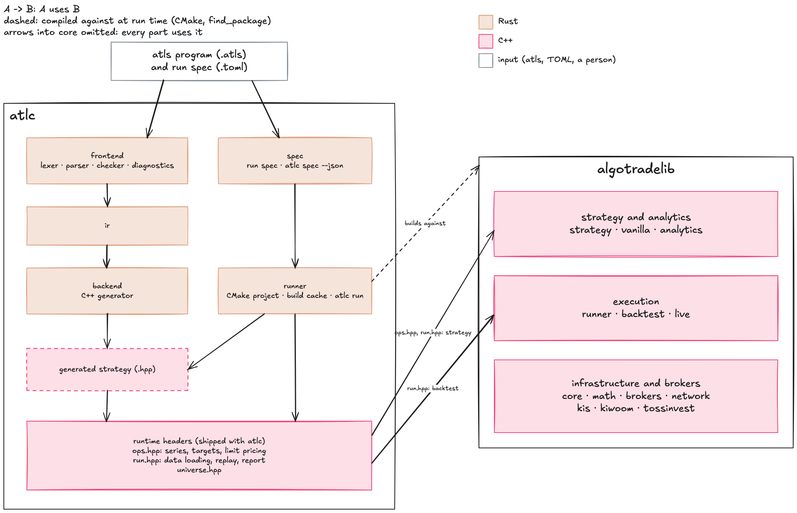

# atlc

<!-- badges: start -->
[](https://github.com/algotradelib/atlc/actions/workflows/rust-check.yaml?query=branch%3Amain)
[](https://github.com/algotradelib/atlc/actions/workflows/cpp-check.yaml?query=branch%3Amain)
[](https://codecov.io/gh/algotradelib/atlc)
<!-- badges: end -->

The compiler for atls, a short strategy language for [algotradelib](https://github.com/algotradelib/algotradelib).
You write a strategy in a few checked blocks; `atlc` turns it into a C++ strategy for the library's runner.
In the prototype, compiled strategies ran as fast in a backtest as the same strategies written by hand in C++.

```atls
# Buy when the price falls well below its recent mean; sell when it comes back.
params {
  int<lower=2> lookback = 20;
  real<lower=0> entry = 2;
  real exit = 0;
  int<lower=0> quantity = 100;
}
series {
  real z = zscore(close, lookback);
}
on_bar {
  if (z < -entry) {
    target(quantity);
  } else if (z > exit) {
    target(0);
  }
}
```

Status: in development, before its first release; the language may change without notice.

```sh
atlc check mean-reversion.atls # parse and check, no C++ toolchain needed
atlc build mean-reversion.atls -o mean-reversion.hpp # the C++ strategy, for your own algotradelib project
atlc run mean-reversion.toml -P lookback=30 # replay it from a run spec and print the report as JSON
atlc spec mean-reversion.toml --json # check a run spec and print its resolved settings, building nothing
```

Add `--json` to `check` for one JSON object per diagnostic, and to `spec` for one JSON object for tools.
A run spec says what to replay the program on:

```toml
strategy = "mean-reversion.atls"

[data]
source = "csv"
file = "bars.csv" # ts (Unix seconds), open, high, low, close, volume
symbol = "AAPL"

[replay]
cash = 100000
commission = 0.0005
```

`atlc run` builds the strategy once per program shape and keeps the build in a cache, so another parameter or other data replays without compiling again; `--fills FILE` writes every fill.
[`examples/`](examples) runs each program shape on a small synthetic file, and the [run spec reference](docs/reference/run-spec.md) has every key.

How atlc's parts (Rust) and its runtime headers (C++) use algotradelib's modules:



## Install

```sh
cargo install --git https://github.com/algotradelib/atlc
```

`atlc check` and `atlc build` need nothing else.
For continuous integration, `ghcr.io/algotradelib/atlc` holds a build of `main` for Linux (x64, arm64), macOS (arm64) and Windows (x64), and the organization's workflows install it with `uses: algotradelib/.github/actions/setup-atlc@main`; before the first release only the latest build is kept.
`atlc run` compiles the generated strategy, so it also needs a C++17 compiler, CMake 3.20 or later and an installed algotradelib; see [its install guide](https://github.com/algotradelib/algotradelib#install).
If algotradelib is installed under a prefix CMake does not search, set `CMAKE_PREFIX_PATH` to that prefix, or name it in the run spec (`[build] algotradelib`).
Reading bars from a Parquet store also needs [DuckDB's C library](https://duckdb.org/docs/installation/) (`duckdb.h` and the shared library), found by `[build] duckdb` or `DUCKDB_ROOT`; CSV data needs nothing more.

## The language

A program is a set of blocks:

| Block | What it holds |
| --- | --- |
| `params {}` | Typed parameters with bounds (`int<lower=2> lookback = 20;`); a tuning grid runs them all from one build |
| `series {}` | Values computed every bar before the handlers, including indicators (`zscore`, `sma`, `ema`, `ols_slope`, ...) |
| `state {}` | Values the handlers keep from bar to bar |
| `on_start`, `on_bar`, `on_fill`, `on_stop` | Handlers; the only output is a target position |
| `instruments {}`, `universe {}` | Several named instruments, or the same program over many |
| `options {}` | How missing values enter windows: `restart`, `skip` or `poison` |
| `functions {}`, `indicator` | Your own functions and streaming indicators |

A program has no I/O and no unbounded loop, and cannot read a future bar: the checker refuses it.
Data, dates, costs and fills come from a run spec, so one program can be replayed on other data or tuned without editing it; a `replay {}` block may carry defaults for sharing one file.
Live trading is not part of atls yet.
The full definition is the [language reference](docs/reference/README.md).

## Acknowledgements

This project was developed with the assistance of generative AI tools.

## Disclaimer

atlc is released under the MIT license; see [LICENSE](LICENSE).
The software is provided as is, without warranty of any kind, and the authors are not liable for any loss, including trading losses, arising from its use.
Nothing in this repository is investment advice.
