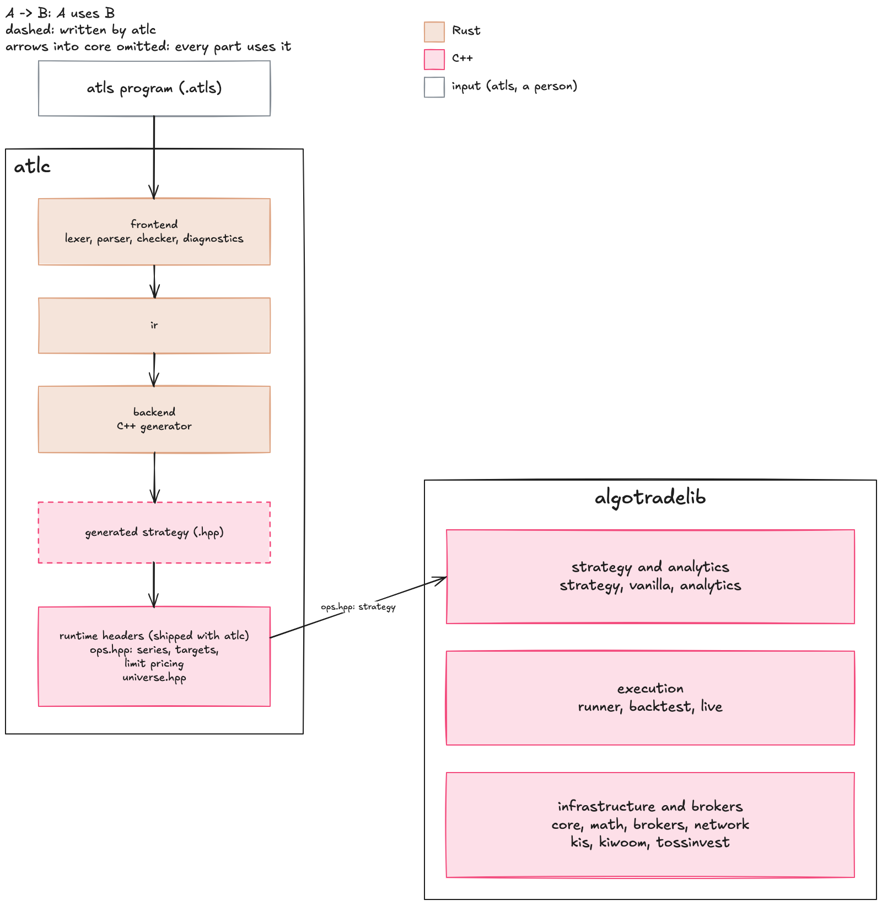

# atlc

<!-- badges: start -->
[](https://github.com/algotradelib/atlc/actions/workflows/rust-check.yaml?query=branch%3Amain)
[](https://github.com/algotradelib/atlc/actions/workflows/cpp-check.yaml?query=branch%3Amain)
[](https://codecov.io/gh/algotradelib/atlc)
<!-- badges: end -->

The compiler for atls, a short strategy language for [algotradelib](https://github.com/algotradelib/algotradelib).
You write a strategy in a few checked blocks; `atlc` turns it into a C++ strategy for the library's runner.
In the prototype, compiled strategies ran as fast in a backtest as the same strategies written by hand in C++.

```atls
// Buy when the price falls well below its recent mean; sell when it comes back.
params {
  int<lower=2> lookback = 20;
  real<lower=0> entry = 2;
  real exit = 0;
  int<lower=0> quantity = 100;
}
series {
  real z = zscore(close, lookback);
}
on_bar {
  if (z < -entry) {
    target(quantity);
  } else if (z > exit) {
    target(0);
  }
}
```

Status: in development, before its first release; the language may change without notice.

```sh
atlc check mean-reversion.atls # parse and check, no C++ toolchain needed
atlc check mean-reversion.atls --info # the struct, mode, instruments and parameters, as one JSON object for tools
atlc build mean-reversion.atls -o mean-reversion.hpp # the C++ strategy, for your own algotradelib project
atlc reference builtins # a chapter of the language reference, as this atlc has it (no name: the index)
```

Add `--json` to `check` for one JSON object per diagnostic.
`atlc` runs no strategy.
[cmdatl](https://github.com/algotradelib/cmdatl) backtests and trades atls programs from the command line, with data, costs and fills in its run settings.
A project of your own includes `atlc build`'s header and the runtime it writes (`atlc build --emit-runtime DIR`) in its own `main`; [the generated C++](docs/reference/generated-code.md) says how to compile it.
[`examples/`](examples) holds a program of each shape, with a small synthetic file and cmdatl run settings for each.

How atlc's parts (Rust) and its runtime headers (C++) use algotradelib's modules:



## Install

```sh
cargo install --git https://github.com/algotradelib/atlc
```

`atlc` needs nothing else.
Compiling the C++ it writes needs a C++17 compiler and an installed algotradelib (see [its install guide](https://github.com/algotradelib/algotradelib#install)); atlc's own C++ tests also need CMake.
For continuous integration, `ghcr.io/algotradelib/atlc` holds a build of `main` for Linux (x64, arm64), macOS (arm64) and Windows (x64), and the organization's workflows install it with `uses: algotradelib/.github/actions/setup-atlc@main`; before the first release only the latest build is kept.

## The language

A program is a set of blocks:

| Block | What it holds |
| --- | --- |
| `params {}` | Typed parameters with bounds (`int<lower=2> lookback = 20;`); a tuning grid runs them all from one build |
| `series {}` | Values computed every bar before the handlers, including indicators (`zscore`, `sma`, `ema`, `ols_slope`, ...) |
| `state {}` | Values the handlers keep from bar to bar |
| `on_start`, `on_bar`, `on_fill`, `on_stop` | Handlers; the only output is a target position |
| `instruments {}`, `universe {}` | Several named instruments, or the same program over many |
| `options {}` | How missing values enter windows: `restart`, `skip` or `poison` |
| `functions {}`, `indicator` | Your own functions and streaming indicators |

A program has no I/O and no unbounded loop, and cannot read a future bar: the checker refuses it.
Data, dates, costs and fills come from whatever runs the strategy, so one program can be replayed on other data or tuned without editing it.
Live trading is not part of atls yet.
The full definition is the [language reference](docs/reference/README.md).

## Acknowledgements

This project was developed with the assistance of generative AI tools.

## Disclaimer

atlc is released under the MIT license; see [LICENSE](LICENSE).
The software is provided as is, without warranty of any kind, and the authors are not liable for any loss, including trading losses, arising from its use.
Nothing in this repository is investment advice.
